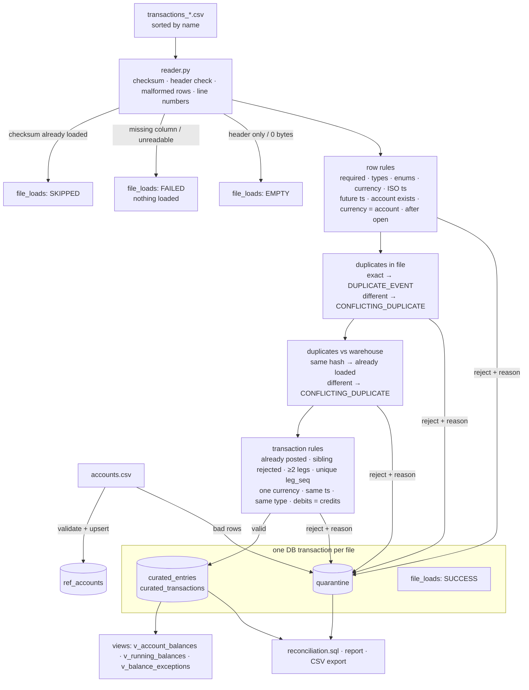

# Architecture

## Actors / systems

| Actor | In this project |
|---|---|
| Source system / file producer | CSV files dropped into an input folder (`transactions_*.csv`) plus a reference `accounts.csv` |
| Storage / processing layer | Python package `txn_pipeline` + embedded DuckDB file (`warehouse/pipeline.duckdb`) |
| Target analytical consumer | curated tables, balance views, CSV exports, `reports/pipeline_report.md` |
| Pipeline operator | CLI (`run`, `check`, `report`, `reset`), `pipeline_runs` / `file_loads` tables, `logs/pipeline.log` |
| Data engineer | config in `config/pipeline.toml`, rules in `validators.py`, checks in `sql/reconciliation.sql` |

## Flow

## Key design points

1. **Validate in Python, store and reconcile in SQL.** The rules are small pure functions that are easy to unit
   test and give one deterministic reason per row. DuckDB handles bulk storage, the anti-join idempotency and
   all set-based checks (balances, reconciliation).
2. **A transaction is all-or-nothing.** If any leg fails, every leg of that transaction is quarantined, so a
   half transaction can never unbalance the curated ledger.
3. **Atomic per file.** Curated rows, quarantine rows and the SUCCESS registration commit together. A crash
   leaves the file unregistered, so the next run retries it.
4. **Append-only curated layer + derived balances.** Balances are computed in event-time order from the
   entries, so late-arriving data does not need any "update" logic and nothing is overwritten.
5. **Two levels of idempotency.** File checksum skip (cheap), plus natural-key anti-joins on insert (safe
   even under `--force` backfills or overlapping files).
